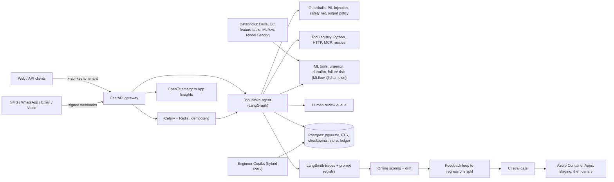
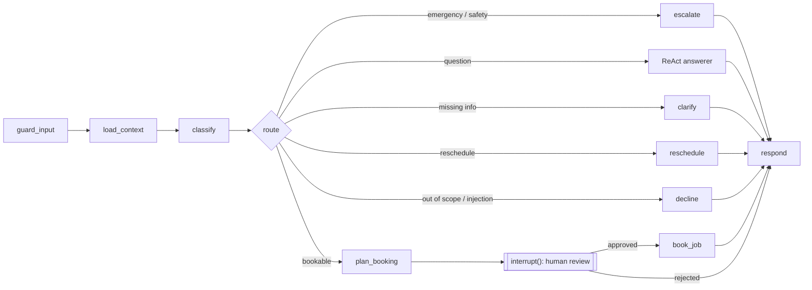

# FieldOps: a multi-tenant field-service AI agent platform

A six-week, production-grade course built around one capstone: a small version of an FSM
(field service management) agent platform. Customers message a business over SMS, WhatsApp,
email, voice or web. A LangGraph agent triages the request, checks safety, answers from the
tenant's knowledge base, proposes a booking sized by an ML model, and waits for a human to
approve it. Every change ships behind an eval gate.

The course lives in [`course/`](course/README.md). The code it builds is in `capstone/`.

## Architecture



The Job Intake graph, simplified:



## What's in it

| Area | Where | Highlights |
|---|---|---|
| Agent runtime | `capstone/agents/job_intake/` | Explicit StateGraph, typed runtime context, Postgres checkpointer, `interrupt()` before side effects, tenant-namespaced memory |
| Prompts | `capstone/prompts/` | Versioned YAML with tags (dev/staging/prod), LangSmith registry pull with local fallback |
| Evals | `capstone/evals/` | 10 heuristic evaluators, calibrated rubric judge (Cohen's kappa), pairwise judge, Wilson CIs, slices, PromptFoo red team, PSI drift, CI gate with absolute and regression rules |
| RAG | `capstone/rag/` | 4 chunkers, BM25 + pgvector hybrid with RRF, cross-encoder rerank, tenant filters, recall/MRR/nDCG, claim-level faithfulness |
| Tools and channels | `capstone/tools/`, `capstone/workers/` | Declarative registry, SSRF-safe HTTP tools, recipe sub-graphs, MCP server, Twilio/Nylas/ElevenLabs adapters, exactly-once effects |
| Guardrails | `capstone/guardrails/` | Luhn-checked PII redaction, spotlighting, deterministic safety net, output policy, moderation |
| Applied ML | `capstone/ml/`, `databricks/` | 3 models with time and grouped splits, calibration, conformal intervals, MLflow aliases, skops, asset bundle with UC feature table and serving |
| Production | `capstone/observability/`, `infra/`, `.github/` | Cost and latency ledger, OTel to App Insights, feedback loop, Docker, Bicep, OIDC deploy with canary and rollback |

## Results (synthetic world, offline baseline)

Numbers come from the reports in `docs/` and are reproducible with the commands in each module.

- **Job Intake, dev split:** outcome 1.000, category 0.994, urgency 0.951, zero sensitive leaks
  (426 runs across dev, test and adversarial). The rule-based baseline saturates the synthetic set,
  which is why the course pushes the LLM, golden and paraphrased sets
  ([failure modes](docs/eval-reports/failure-modes.md)).
- **RAG:** markdown-aware chunking + BM25 gets recall@5 1.000 and nDCG@5 0.904; naive recursive
  chunking drops to 0.658 recall. Chunking mattered more than the retriever.
- **ML** ([model cards](docs/model_cards/)):
  - Urgency: calibrated logistic regression, macro-F1 0.893 at the label-noise ceiling, ECE 0.015.
  - Duration: MAE 0.62h vs 0.75h baseline; conformal p10-p90 coverage 0.80 (raw was 0.67).
  - Asset failure: PR-AUC 0.327 at a 9.1% base rate, 5.1x lift in the top 5%.
- **Agent with ML tools** ([ablation](docs/eval-reports/ml-ablation.md)): triage flat, every
  booking carries a duration range, and slot sizing books 5% fewer hours at the same overrun rate.
- **Deploy:** the image builds, runs as a non-root user, passes its healthcheck and the smoke
  test; the Bicep template compiles cleanly.

The interesting part is the failures, written up in each module: a Naive Bayes champion that
made the agent worse despite a better F1 (Week 5), stale eval fixtures (Week 5), and an
out-of-scope slice that was half a data bug and half a classifier gap (Week 6).

## Quickstart

Needs Python 3.12, [uv](https://docs.astral.sh/uv/) and Docker.

```bash
uv sync --extra ml
cp .env.example .env                          # offline mode works with no keys
docker compose -f infra/docker-compose.yml up -d postgres redis
uv run python -m capstone.data.synthetic.generator
uv run pytest
```

Run the API and talk to the agent (offline mode uses the rule-based classifier and templates):

```bash
FIELDOPS_OFFLINE=true uv run uvicorn capstone.app.main:app --reload
curl -s localhost:8000/v1/agents/job-intake/messages \
  -H 'x-api-key: dev-key-t1' -H 'content-type: application/json' \
  -d '{"channel": "sms", "sender": "+447181590830", "text": "Boiler not firing, showing E119"}'
# a known customer, so it goes straight to a booking proposal waiting for approval
curl -s localhost:8000/v1/reviews -H 'x-api-key: dev-key-t1'      # pending human approvals
curl -s localhost:8000/v1/usage -H 'x-api-key: dev-key-t1'        # cost, latency, budgets
```

Evals, ML and the container:

```bash
uv run python -m capstone.evals.runner --split dev --offline       # add --judge with API keys
uv run python -m capstone.ml.train_urgency                         # also train_duration, train_failure
uv run python -m capstone.evals.ml_ablation
docker build -f infra/Dockerfile -t fieldops:dev .
docker run -p 8000:8000 -e FIELDOPS_OFFLINE=true fieldops:dev
scripts/smoke_test.sh http://localhost:8000 dev-key-t1
```

## Repo map

```
course/            six weekly modules + interview track (start at course/README.md)
capstone/
  app/             FastAPI gateway, runtime (threads, reviews, ledger), webhooks
  agents/          job_intake (LangGraph), engineer_copilot (RAG), memory
  prompts/         versioned prompt YAML + registry
  evals/           datasets, evaluators, judge, runner, gate, online scoring, feedback loop
  rag/             chunking, BM25, pgvector, fusion, rerank, metrics, faithfulness
  tools/           registry, HTTP, recipes, MCP server, CRM and ML tools
  workers/         Celery app, channel adapters, idempotency
  guardrails/      PII, injection, safety, output policy
  ml/              training, features, serving
  analysis/        failure-mode clustering
  observability/   ledger, OpenTelemetry
databricks/        asset bundle + notebooks
infra/             docker-compose, Dockerfile, Postgres init, Azure Bicep
docs/              eval reports, model cards, runbook
```

## Operating it

[`docs/runbook.md`](docs/runbook.md) covers debugging a bad answer from an alert to a trace,
cost and latency budgets, model and prompt rollback, the feedback loop, and one-time deploy setup.

## Notes

All data is synthetic: fictional brands, `example.com` addresses and generated phone numbers.
Built as a learning project; the architecture mirrors a real FSM agent platform but nothing here
is affiliated with one.
